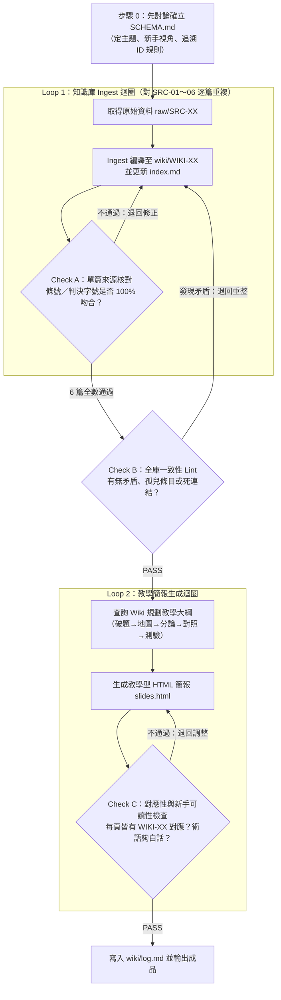

# 作業繳交報告：用 LLM Wiki 製作教學 HTML 簡報

> **建議繳交標題**：`北大 411271446 司法四 蕭煜詮 刑法阻卻違法事由入門`

---

## 一、LLM Wiki 主題與簡短介紹

- **主題**：**刑法阻卻違法事由入門**（台灣《中華民國刑法》第 21～24 條與超法規阻卻違法事由）
- **簡短介紹**：
  一般沒有法律背景的民眾常有一個疑問：「為什麼同樣是打傷人、打破窗戶或動手術，有些構成犯罪，有些法律卻說不罰？」本專案採用「**先討論、後生成**」的方式，先定義知識庫規範（`SCHEMA.md`），再蒐集並逐篇 Ingest **6 篇原始資料**（涵蓋刑法第 21～24 條全文、最高法院 108 台上 62／112 台上 537／109 台上 5037 判決意旨、依法令與業務正當行為、超法規得被害人承諾、三階層犯罪論），建構出具備雙向交叉連結與來源追溯的 LLM Wiki，最後以此 Wiki 為唯一知識來源，製作出 10 頁可互動瀏覽的新手教學型 HTML 簡報。

---

## 二、LLM Wiki 與教學 HTML 簡報成果連結

- **LLM Wiki 公開網頁連結**：https://yuchuanhsiao.github.io/lawnotes/llm-wiki-criminal-law/index.html
- **教學型 HTML 簡報公開連結**：https://yuchuanhsiao.github.io/lawnotes/llm-wiki-criminal-law/slides.html
- **LLM Wiki GitHub 原始檔案庫**：https://github.com/YuChuanHsiao/lawnotes/tree/main/llm-wiki-criminal-law
  - 包含 `SCHEMA.md`、`raw/01`～`raw/06`（6 篇原始來源）、`wiki/index.md`、`wiki/log.md`、`wiki/concepts/*.md`、`wiki/comparisons/defense-vs-necessity.md`

### Wiki 條目與教學簡報對應表

| 簡報頁次 | 簡報主題 | 對應 Wiki 條目 ID | 原始來源追溯 |
| :--- | :--- | :--- | :--- |
| 第 1 頁 | 生活情境破題：看起來像犯罪為何不罰？ | `WIKI-01`～`06` 總覽 | `SRC-01`～`06` |
| 第 2 頁 | 刑法三階層犯罪審查地圖（T → R → S） | `WIKI-01` | `SRC-06`, `SRC-01` |
| 第 3 頁 | 正當防衛與防衛過當（刑法 §23） | `WIKI-02` | `SRC-01`, `SRC-02` |
| 第 4 頁 | 緊急避難與避難過當（刑法 §24） | `WIKI-03` | `SRC-01`, `SRC-03` |
| 第 5 頁 | 依法令、上級命令、業務正當與被害人承諾 | `WIKI-04`, `WIKI-05` | `SRC-01`, `SRC-04`, `SRC-05` |
| 第 6 頁 | 正當防衛 vs. 緊急避難 終極對照 | `WIKI-06` | `SRC-01`, `SRC-02`, `SRC-03` |
| 第 7–9 頁 | 3 題生活案例互動隨堂測驗 | `WIKI-01`, `WIKI-02`, `WIKI-03`, `WIKI-06` | `SRC-02`, `SRC-03`, `SRC-06` |
| 第 10 頁 | 學習總結與 LLM Wiki 流程回顧 | `index.md`, `log.md` | 全部來源 |

---

## 三、Loop / Graph 流程設計

本專案採用「**雙迴圈（Dual-Loop）＋ 三道前置檢查閘門（Gate Checks）**」架構，將知識建構與簡報產出拆開並各自加上驗證迴圈：

### 設計細節說明
1. **哪些步驟會重複執行？**
   - **Loop 1（取得資料 → Ingest → Check A）**：對 `SRC-01`～`SRC-06` 逐篇重複執行 6 次，每次只處理單一主題來源，確保法條與判決引用精準，再更新 `wiki/index.md`。
   - **Loop 2（查詢 Wiki → 產出簡報 → Check C）**：針對每一頁投影片檢視是否能回溯到 `WIKI-XX` 條目、以及是否符合「無法律背景者也能看懂」的教學標準，不達標即針對該頁重新生成。
2. **哪些地方需要檢查或重新生成？**
   - **Check A（Ingest 後）**：檢查刑法條號（§21～§24）、最高法院判決字號（108 台上 62、112 台上 537、109 台上 5037）與原文字意是否一致，避免 LLM 幻覺。
   - **Check B（全庫 Lint）**：跨條目比對邏輯一致性（例如三階層歸屬、正當防衛與緊急避難要件是否互相矛盾）、檢查有無孤兒條目或斷裂連結。
   - **Check C（簡報產出後）**：檢查簡報與 Wiki 是否明確對應、文字量是否過載、專業法律術語是否皆附白話翻譯與生活案例。
3. **為什麼這樣設計？**
   - 法律教學最怕兩件事：**「引用錯法條／觀念矛盾」** 與 **「術語太硬、新手看不懂」**。將「事實與體系正確性」鎖在 Loop 1 + Check A/B，將「教學結構與白話表達」鎖在 Loop 2 + Check C，可避免在生成 HTML 簡報後才發現底層知識錯誤而必須整份重做。

---

## 四、一次實際執行的結果與檢查紀錄

完整日誌亦收錄於 `wiki/log.md`：

1. **Run 01（先討論、後生成）**：先確立主題為「刑法阻卻違法事由入門」、設定目標讀者為新手，並寫成 `SCHEMA.md`，強制每篇 Wiki 條目須包含「一句話白話定義」與「生活化正反案例」。
2. **Run 02（6 篇資料 Ingest）**：透過網路查證法務部法規條文與最高法院實務見解，整理 6 篇原始檔（`SRC-01`～`SRC-06`）並逐篇 Ingest 成 `WIKI-01`～`WIKI-06`。
3. **Run 03（Check B 全庫一致性 Lint — 實際攔截並修正 1 項觀念錯誤）**：
   - **發現問題**：初稿在整理「防衛過當」時，曾誤將其與正當防衛一併歸類在「第二關阻卻違法」，與 `SRC-01`、`SRC-02` 及 `SRC-03`（最高法院 109 台上 5037）之「過當行為仍屬違法，僅於第三關罪責層次減輕或免除其刑」互相矛盾。
   - **修正結果**：同步修正 `WIKI-01`、`WIKI-02`、`WIKI-03`、`WIKI-06`，並直接把這個最容易考倒新手的觀念做成簡報第 2 頁提醒與第 9 頁互動測驗題。
4. **Run 04（Check C 簡報可讀性檢查 — 實際攔截並優化 1 處教學表達）**：
   - **發現問題**：第 6 頁（正當防衛 vs. 緊急避難對照表）初版保留過多法律專有名詞（「補充性原則」「衡平性原則」「權利濫用禁止」），對非法律系讀者過於生硬。
   - **修正結果**：在簡報中改以白話對照呈現（如「補充性＝真的沒別招了」、「優越利益＝救大的、犧牲小的」），加上一句話口訣，並為每一頁補上可點擊回跳 `index.html#WIKI-XX` 的來源徽章。

---

## 五、反思

1. **哪一個節點最常出錯？**
   - 最常出錯的是 **「Ingest 編譯至 Wiki」** 與 **「從 Wiki 轉譯為新手簡報」** 這兩個節點。
   - 在 Ingest 節點，LLM 容易把相近的法律概念混在一起（例如把緊急避難的「不得已」誤套到正當防衛，或把「防衛過當」誤歸類為阻卻違法）；在簡報生成節點，則容易直接照抄 Wiki 的學術術語，忽略新手的閱讀負擔。
2. **發現問題後，把檢查往前移到了哪一個步驟？**
   - 原本很容易等到最後 HTML 簡報做好、肉眼瀏覽時才發現觀念矛盾或術語太硬。發現問題後，我把檢查大幅往前移：
     - 將「條號／判決核對與三階層歸屬確認」前移到 **Check A（每篇 Ingest 後）與 Check B（全庫 Lint）**，確保錯誤不會流進簡報。
     - 將「白話定義與生活正反案例」的要求前移到最開頭的 **`SCHEMA.md` 條目模板**，在編寫 Wiki 時就先準備好新手友善素材。
3. **有沒有因此修改 workflow / graph？為什麼？**
   - **有**。最初的構想只是線性流程（`蒐集資料 → 寫 Wiki → 做簡報 → 最後檢查`），但實際執行發現線性流程一旦在最後抓到觀念錯誤，就得同時改 Wiki 又改簡報，成本太高。因此改為上述的 **雙迴圈＋三道 Gate Check** 架構，讓「知識正確性」在進入簡報階段前就被 Check A / B 鎖死，簡報階段的 Check C 則專心把關「Wiki 對應性」與「教學易懂度」，整體返工率大幅降低。
